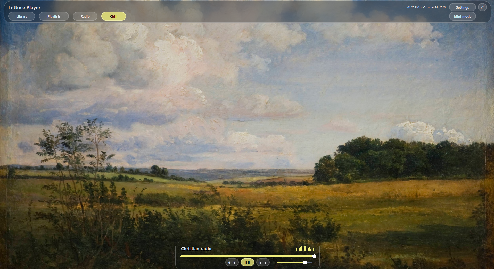
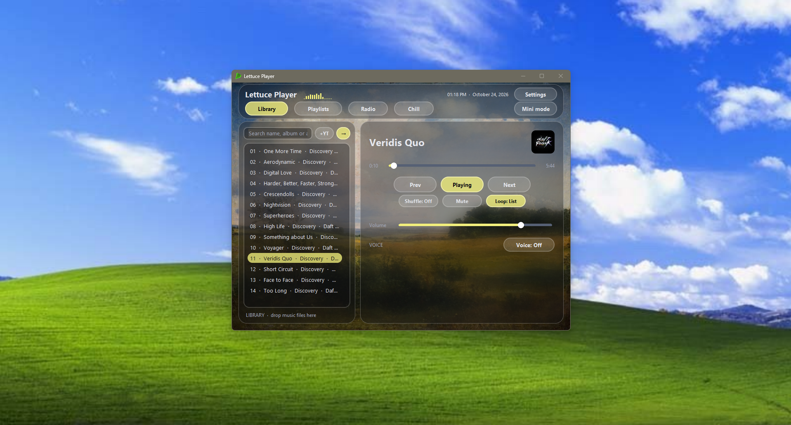

# Why Lettuce Player?

- It looks so darn good
- Entirely offline Speech-to-Text using Vosk
  - say play ___ or stop or resume to control your music with Vosk!
- YouTube songs can be added like the rest of your music (handy!)
- Intuitive song management
  - fast playlists
  - convenient library/playlist filtering and searching
  - quick metadata & album art editing for multiple songs at a time
- Built in lyrics support using .lrc files
- Like to listen to ambience with your music? I've got you! Use the built in dual player
    - Middle click to select a second song which will open player #2!
    - Using this, you can have a YouTube ambience playlist on shuffle while you
    listen to whatever music you'd like!
- Just like the radio? Use the built in http radio tab and organize your favorites however you'd like!

Vosk Licensing statment:
// Copyright 2020-2021 Alpha Cephei Inc.
//
// Licensed under the Apache License, Version 2.0 (the "License");
// you may not use this file except in compliance with the License.
// You may obtain a copy of the License at
//
//       http://www.apache.org/licenses/LICENSE-2.0
//
// Unless required by applicable law or agreed to in writing, software
// distributed under the License is distributed on an "AS IS" BASIS,
// WITHOUT WARRANTIES OR CONDITIONS OF ANY KIND, either express or implied.
// See the License for the specific language governing permissions and
// limitations under the License.

 

